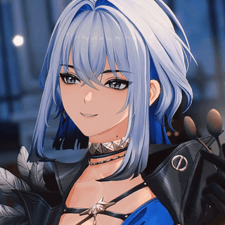
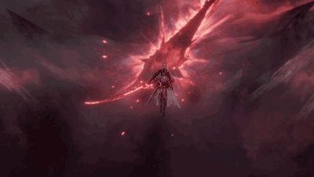
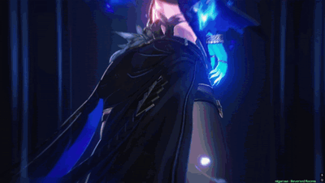
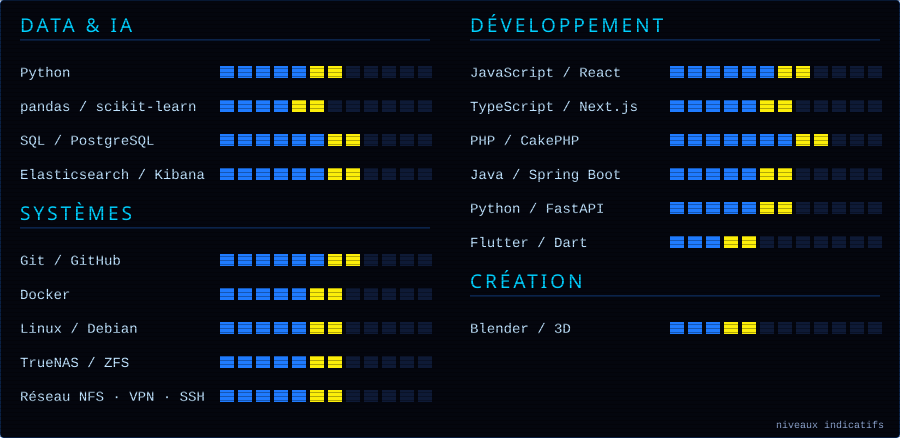
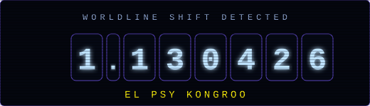

 

<table>
<tr>
<td width="38%" align="center" valign="middle">

 
<b>GALBRENA</b> · Wuthering Waves

</td>
<td width="62%" valign="top">

### Salut choom, bienvenue dans ma zone. · Hey choom, welcome to my zone.

**FR** — Ici on parle d'**univers** et de **projets** : de la data qui recommande, des jeux qu'on libère de leur borne, un homelab qui ronronne et de la 3D sous Blender.
Fan de **JRPG** (*Xenoblade*, *Fire Emblem*, *Final Fantasy*, *Persona*) et d'**animes** (*Steins;Gate*, *86*, *Fate/Zero*, *Gurren Lagann*)… et de bien d'autres, parce que j'adore les jeux et les animes.

**EN** — Here it's all about **worlds** and **projects**: data that recommends, games freed from their arcade cabinets, a humming homelab and 3D work in Blender.
**JRPG** fan (*Xenoblade*, *Fire Emblem*, *Final Fantasy*, *Persona*) and **anime** fan (*Steins;Gate*, *86*, *Fate/Zero*, *Gurren Lagann*)… and plenty more, because I simply love games and anime.

> *Dans cette ville, tout le monde vend des données. Moi, je les fais parler.*
> *In this city, everyone sells data. I make it talk.*

Aussi connu sous le nom de · Also known as **ShikiKaizer_** — [X (@11cherxn_)](https://x.com/11cherxn_) · [Instagram](https://www.instagram.com/ShikiKaizer_/) · [TikTok](https://www.tiktok.com/@ShikiKaizer_)

</td>
</tr>
</table>

<table>
<tr>
<td width="33%" align="center" valign="top"> <b>DATA &amp; IA</b> Acheron · Honkai: Star Rail Recommandations expliquées, profils de joueurs, tableaux de bord.</td>
<td width="34%" align="center" valign="top"> <b>PRÉSERVATION DE JEUX</b> Lucia · Punishing: Gray Raven Libérer des jeux de leur borne ou de leur console, jouables sur PC.</td>
<td width="33%" align="center" valign="top"> <b>HOMELAB &amp; SYSTÈMES</b> Galbrena · Wuthering Waves NAS, serveur Debian, tout est automatisé.</td>
</tr>
</table>

 

   

Les contrats « classifiés » sont des dépôts privés.

 

 

<b>▸ ACCÈS RESTREINT — clique pour pirater le terminal</b>

 

**ShikiKaizer_** sur **[X (@11cherxn_)](https://x.com/11cherxn_)** &nbsp;·&nbsp; **[Instagram](https://www.instagram.com/ShikiKaizer_/)** &nbsp;·&nbsp; **[TikTok](https://www.tiktok.com/@ShikiKaizer_)**

**🐙 [Open Games Awards](https://github.com/Dimi-Sama/open-games-awards)**

 

Fan content : Galbrena (Wuthering Waves) et Lucia (Punishing: Gray Raven) © Kuro Games · Acheron (Honkai: Star Rail) © HoYoverse. 
GIF via Tenor. Ce profil n'est affilié à aucun studio. Les visuels animés (bannière, HUD, jauges) sont faits maison en SVG. 
<b>El Psy Kongroo.</b>

